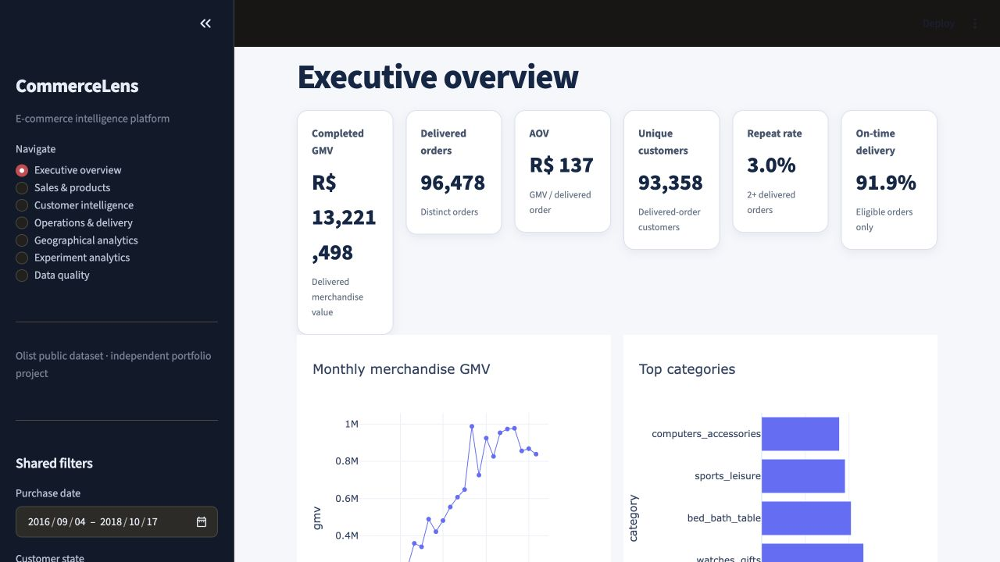
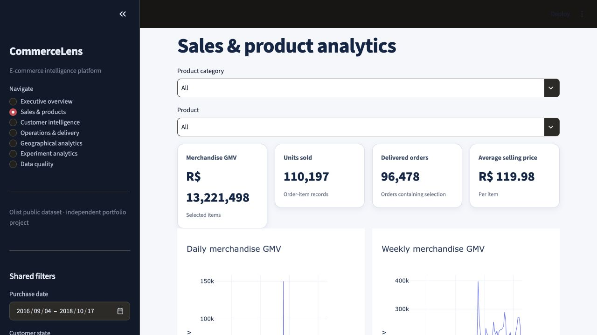
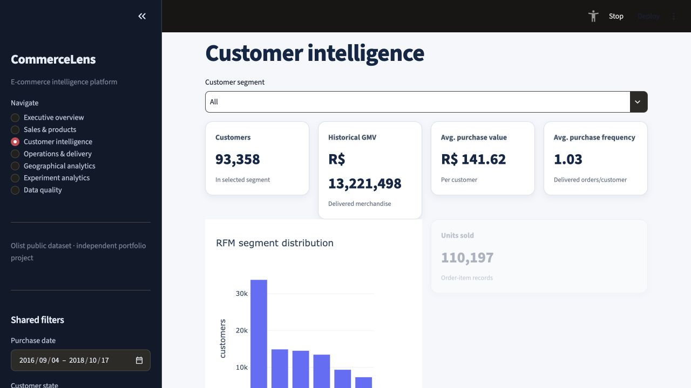
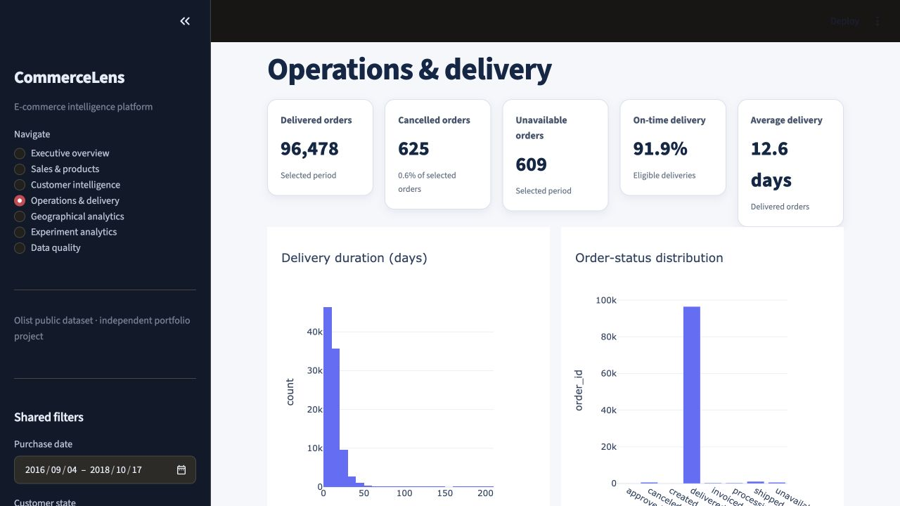
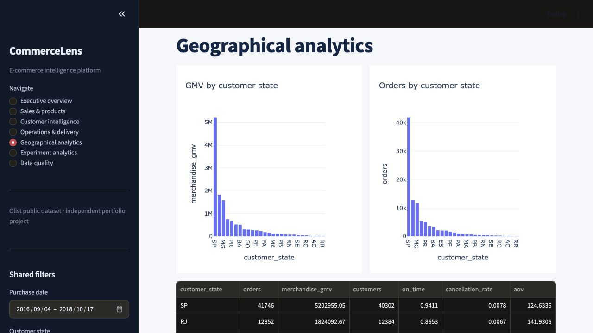
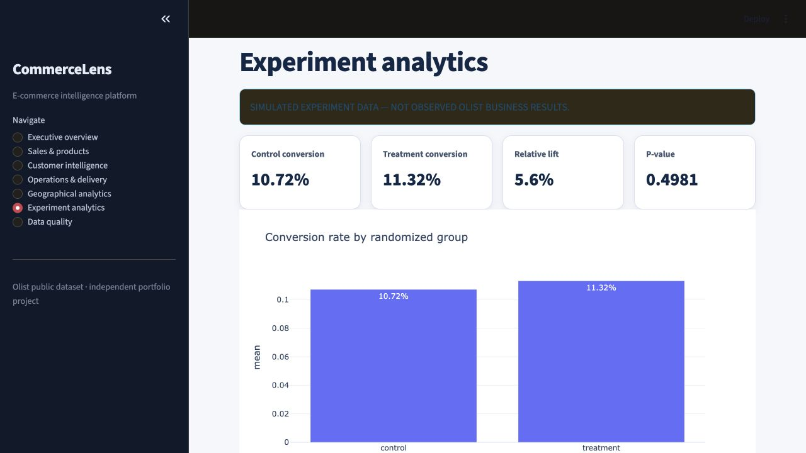

<div align="center">


# ◈ CommerceLens

### End-to-End E-Commerce Intelligence Platform

**[🚀 Live Dashboard](https://commercelens-project-s4fgslwshmpgrz4a2mxhap.streamlit.app/)** · **[📂 Repository](https://github.com/SiddharthaShukla8/CommerceLens-Project)**

> A production-grade analytics platform built on 100,000+ real Brazilian e-commerce transactions — from raw CSVs to a fully deployed interactive dashboard with persistent global filters, RFM segmentation, A/B testing, and automated CI.

</div>

---

## 📸 Dashboard Preview

| Executive Overview | Customer Intelligence |
|:---:|:---:|
|  |  |

| Operations & Delivery | Geographical Analytics |
|:---:|:---:|
|  |  |

| Experiment Analytics | Data Quality |
|:---:|:---:|
|  |  |

---

## 🎯 What This Project Demonstrates

CommerceLens is a **complete end-to-end data engineering and analytics portfolio project** built on the public [Olist Brazilian E-Commerce Dataset](https://www.kaggle.com/datasets/olistbr/brazilian-ecommerce) (99,441 orders, 9 source CSV files). It demonstrates every layer of the modern data stack — from raw ingestion to live production deployment.

### Core Capabilities

| Capability | Implementation |
|---|---|
| **ETL Pipeline** | Multi-stage ingestion → cleaning → validation → export |
| **Analytical Database** | Star-schema PostgreSQL with fact and dimension tables |
| **Interactive Dashboard** | 7-page Streamlit app deployed on Streamlit Community Cloud |
| **Persistent Global Filters** | Date range, state, and status retained across all 7 pages |
| **Customer Analytics** | RFM segmentation, cohort retention analysis |
| **Operational Analysis** | Delivery SLA tracking, carrier performance, delayed order detection |
| **Geographical Analytics** | Per-state GMV, AOV, cancellation rate, on-time delivery |
| **A/B Test Analysis** | Seeded synthetic checkout experiment with statistical significance |
| **Data Quality Monitoring** | Pipeline metadata, automated quality checks |
| **Automated Testing** | 15 pytest tests, Streamlit AppTest filter-persistence suite |
| **CI/CD** | GitHub Actions workflow — lint, compile, full test suite |
| **Cloud Deployment** | Neon Serverless PostgreSQL + Streamlit Cloud |

---

## 🏗️ Architecture

```
┌──────────────────────────────────────────────────────────────────┐
│                        DATA SOURCES                              │
│  9 Olist CSVs: orders, customers, products, sellers,             │
│  payments, reviews, order items, geolocation, translation        │
└───────────────────────────┬──────────────────────────────────────┘
                            │
                            ▼
┌──────────────────────────────────────────────────────────────────┐
│                       ETL PIPELINE  (src/)                       │
│  Ingestion → Profiling → Cleaning → Validation → Audit Export    │
│  • 20+ business rules validated                                  │
│  • Cleaning audit trail generated                                │
│  • Processed CSVs + analytical exports written                   │
└───────────────────────────┬──────────────────────────────────────┘
                            │
                 ┌──────────┴──────────┐
                 ▼                     ▼
┌──────────────────────┐  ┌───────────────────────────┐
│  PostgreSQL Analytics │  │  Flat-file Export Fallback │
│  Schema (database/)  │  │  data/exports/*.csv         │
│  • fact_orders       │  │  • order_mart.csv           │
│  • fact_order_items  │  │  • item_mart.csv            │
│  • dim_customers     │  │  • rfm_segments.csv         │
│  • dim_products      │  │  • cohort_retention.csv     │
│  • dim_sellers       │  │  • data_quality.csv         │
│  • analytics views   │  └───────────────┬────────────┘
└──────────┬───────────┘                  │
           └──────────────────┬───────────┘
                              ▼
┌──────────────────────────────────────────────────────────────────┐
│               STREAMLIT DASHBOARD  (app.py)                      │
│  7 pages · Persistent global filters · Real-time filter updates  │
│  Executive · Sales · Customers · Operations · Geo · A/B · DQ    │
└──────────────────────────────────────────────────────────────────┘
                              │
                   ┌──────────┴──────────┐
                   ▼                     ▼
        ┌──────────────────┐  ┌────────────────────┐
        │  Neon Serverless │  │  Streamlit Cloud    │
        │  PostgreSQL      │  │  Deployed App       │
        │  (Production DB) │  │  (Live URL)         │
        └──────────────────┘  └────────────────────┘
```

---

## 🔧 Technical Stack

| Layer | Technology | Purpose |
|---|---|---|
| Language | Python 3.11+ | Core pipeline and analytics logic |
| Data processing | pandas 2.x, NumPy | Transformation, aggregation, RFM |
| Database | PostgreSQL 16, SQLAlchemy 2.x, psycopg3 | Analytical schema and query layer |
| Serverless DB | Neon (pooled + unpooled connections) | Production cloud database |
| Dashboard | Streamlit 1.40+, Plotly 5.x | Interactive visualizations |
| Statistical analysis | SciPy | A/B test significance (Welch's t-test) |
| Reporting | ReportLab PDF, CSV | Automated business reports |
| Testing | pytest, Streamlit AppTest | Unit, integration, and UI tests |
| CI/CD | GitHub Actions | Compile check, full test suite |
| Containerisation | Docker, Docker Compose | Local PostgreSQL environment |

---

## 📊 Dashboard Pages

### 1. Executive Overview
Real-time KPI cards for Completed GMV, Delivered Orders, AOV, Unique Customers, Repeat Rate, and On-Time Delivery. Monthly GMV trend chart with correct calendar-period labels. Top-5 category breakdown. Evidence-based actions derived from RFM analysis.

### 2. Sales & Products
Interactive category and product drill-down. Daily and weekly GMV trend charts with categorical date axes (no fractional-second rendering artefacts). Category GMV ranking. Product performance table with download.

### 3. Customer Intelligence
RFM segmentation (Recency, Frequency, Monetary) with per-segment recommended actions. Cohort retention heatmap. Customer segment distribution and GMV histogram.

### 4. Operations & Delivery
Delivery duration histogram. Order-status distribution (with readable "Order count" axis). Delayed order list with days-late calculation. Top-20 sellers by delivered GMV.

### 5. Geographical Analytics
Per-state GMV, order volume, AOV, on-time delivery rate, and cancellation rate. Dual bar charts for state ranking by GMV and volume.

### 6. Experiment Analytics
Synthetic seeded A/B test on checkout flow. Control vs. treatment conversion, relative lift, p-value (Welch's t-test), and 95% confidence interval. Clearly labeled as simulated data — not real Olist business results.

### 7. Data Quality & Pipeline Monitoring
Pipeline health checks, row counts, and ETL metadata. Download link for the full quality audit. Fallback messaging when running from PostgreSQL without local pipeline exports.

---

## 🔑 Persistent Global Filters

One of the key engineering features of this dashboard is **fully persistent global filter state** across all seven pages:

- **Purchase date range** — select any date window, navigate freely, and return to find it intact.
- **Customer state** — multi-select Brazilian state codes (SP, RJ, MG, AM, SC, …).
- **Order status** — multi-select any combination of delivered, shipped, canceled, etc.

Filters update **every chart and KPI** on transactional pages instantly. Experiment Analytics and Data Quality retain the filter selections in the sidebar but correctly do not apply transactional filters to their independent datasets. Filters reset **only when the user explicitly clicks Reset filters**.

This persistence was implemented using stable `st.session_state` keys (`global_date_range`, `global_customer_states`, `global_order_statuses`) with unconditional widget rendering — preventing Streamlit from discarding widget state when navigating between pages.

---

## 📐 Key Metric Definitions

| Metric | Definition |
|---|---|
| **Completed GMV** | Sum of item prices for delivered orders (excludes freight; not profit) |
| **AOV** | Delivered merchandise GMV ÷ delivered order count |
| **Repeat purchase rate** | Customers with ≥ 2 delivered orders ÷ customers with ≥ 1 delivered order |
| **On-time delivery** | Delivered orders where `delivered_date ≤ estimated_delivery_date` |
| **RFM Score** | Recency × Frequency × Monetary quintile composite per customer |

> Payment and order-item fact tables are **never joined directly** for revenue to prevent fan-out multiplication at different grains.

---

## ⚙️ Getting Started

### Prerequisites

- Python 3.11 or newer
- Docker Desktop / Docker Engine (optional, for local PostgreSQL)
- Nine CSV files from the [Olist dataset on Kaggle](https://www.kaggle.com/datasets/olistbr/brazilian-ecommerce)

### Quick Start

```bash
# 1. Clone the repository
git clone https://github.com/SiddharthaShukla8/CommerceLens-Project.git
cd CommerceLens-Project

# 2. Create and activate virtual environment
python3 -m venv .venv
source .venv/bin/activate        # Windows: .venv\Scripts\activate

# 3. Install dependencies
python -m pip install -r requirements.txt

# 4. Configure environment
cp .env.example .env
# Edit .env with your DATABASE_URL if using PostgreSQL

# 5. Place Olist CSVs in data/raw/
# (Filenames listed in config/settings.py)

# 6. Validate source data
python -m src.cli validate

# 7. Run the pipeline and load PostgreSQL
docker compose up -d                        # Start local PostgreSQL
python -m src.cli run-all --database        # ETL + load

# 8. Launch the dashboard
streamlit run app.py
```

### Using Neon Serverless PostgreSQL

```bash
# Install Neon CLI and authenticate
nvm use                # Node 22 pinned in .nvmrc
neon login
neon init && neon deploy

# Load the dataset into Neon
python -m src.cli run-all --database
```

The app reads `DATABASE_URL` (pooled connection for the dashboard) and `DATABASE_URL_UNPOOLED` (direct connection for the ETL loader). Both are set in `.env` by the Neon CLI and are excluded from Git.

---

## 🧪 Testing

```bash
# Run the full test suite
pytest -q

# Run only filter-persistence AppTest suite
pytest tests/test_filter_persistence.py -v

# Compile-check all Python modules
python -m compileall -q app.py config dashboard src tests
```

**Test suite (15 passed, 2 skipped):**

| File | Tests | Description |
|---|---|---|
| `test_analytics.py` | 3 | KPI grain safety, RFM calculation |
| `test_cleaning_validation.py` | 1 | Data cleaning business rules |
| `test_customer_analytics.py` | 3 | RFM and cohort correctness |
| `test_dashboard_data.py` | 1 | Filter function correctness |
| `test_pipeline_controls.py` | 2 | Run-lock and pipeline controls |
| `test_postgres_integration.py` | 2 (skipped) | Disposable PostgreSQL schema checks |
| `test_filter_persistence.py` | 5 | Full 7-page navigation + reset sequence |

The AppTest filter-persistence tests run entirely with a **deterministic in-memory fixture** (`COMMERCELENS_TEST_MODE=1`) — no production credentials, no Olist CSVs, and no database required.

---

## 🚀 CI/CD

GitHub Actions runs on every push and pull request to `main`:

```yaml
- Checkout code
- Setup Python 3.13
- Install requirements
- python -m compileall -q .      # Syntax check every module
- pytest -q                       # Full test suite with COMMERCELENS_TEST_MODE=1
- docker build -t commercelens:ci .  # Confirm Docker image builds
```

The PostgreSQL integration tests are separately gated behind `RUN_POSTGRES_TESTS=1` and use a disposable containerised database — production Neon credentials are never required or exposed in CI.

---

## 📁 Project Structure

```
CommerceLens-Project/
├── app.py                      # Streamlit dashboard entry point (7 pages, persistent filters)
├── requirements.txt            # Python dependencies
├── Dockerfile                  # Production container image
├── docker-compose.yml          # Local PostgreSQL service
├── Makefile                    # Convenience targets
│
├── src/                        # Pipeline and analytics library
│   ├── cli.py                  # CLI entry point (validate, pipeline, run-all, report)
│   ├── pipeline.py             # Orchestrator
│   ├── ingestion/              # CSV reader and profiling
│   ├── cleaning/               # Business-rule cleaning
│   ├── validation/             # Quality checks and audit
│   ├── database/               # Schema creation and bulk loader
│   ├── analytics/              # RFM, cohorts, A/B testing, KPIs, insights
│   └── reporting/              # PDF and CSV report generation
│
├── dashboard/                  # Dashboard utilities
│   ├── data.py                 # Data access + deterministic test fixture
│   └── components/ui.py        # KPI card and CSS injection
│
├── database/                   # PostgreSQL model
│   ├── schema.sql              # Star schema DDL
│   ├── views.sql               # Pre-aggregated analytical views
│   ├── indexes.sql             # Query performance indexes
│   └── migrations/             # Incremental schema migrations
│
├── sql/                        # 20 standalone business-analysis queries
│   ├── 01_monthly_gmv.sql
│   ├── 03_top_categories.sql
│   ├── 05_repeat_rate.sql
│   ├── 13_cohort_retention.sql
│   ├── 15_delayed_deliveries.sql
│   └── ...                     # (17 more covering sales, customers, ops, geo)
│
├── tests/                      # Automated test suite
│   ├── test_analytics.py
│   ├── test_filter_persistence.py   # AppTest 7-page navigation + reset
│   ├── test_postgres_integration.py
│   └── ...
│
├── docs/                       # Documentation and screenshots
│   ├── screenshots/            # Dashboard screenshots (all 7 pages)
│   ├── ARCHITECTURE.md
│   ├── DATABASE.md
│   ├── KPI_DICTIONARY.md
│   ├── ETL.md
│   ├── DEPLOYMENT_GUIDE.md
│   └── DATASET_SETUP.md
│
├── powerbi/                    # Power BI integration
│   ├── README.md               # Connection guidance
│   └── measures.dax            # DAX measures matching Python KPI definitions
│
├── config/
│   ├── settings.py             # All environment settings and paths
│   └── metrics.py              # Metric configuration
│
└── .github/workflows/ci.yml    # GitHub Actions CI workflow
```

---

## 🌐 Deployment

The live dashboard is deployed at:

**[https://commercelens-project-s4fgslwshmpgrz4a2mxhap.streamlit.app/](https://commercelens-project-s4fgslwshmpgrz4a2mxhap.streamlit.app/)**

| Component | Platform |
|---|---|
| Dashboard | Streamlit Community Cloud |
| Database | Neon Serverless PostgreSQL |
| Container | Docker (local development) |
| CI | GitHub Actions |

The deployed app connects to Neon PostgreSQL via a pooled connection string (`DATABASE_URL`). No CSV files, no `.env`, and no Olist raw data are present in the production image — the app reads directly from the cloud database.

---

## 📋 SQL Query Catalog

The `sql/` directory contains 20 independently runnable business-analysis queries:

| # | Query | Business Question |
|---|---|---|
| 01 | `monthly_gmv.sql` | Monthly merchandise GMV trend |
| 02 | `top_products.sql` | Top products by revenue |
| 03 | `top_categories.sql` | Category GMV breakdown |
| 04 | `repeat_customers.sql` | Repeat purchase behaviour |
| 05 | `repeat_rate.sql` | Repeat purchase rate calculation |
| 06 | `highest_spending_customers.sql` | High-value customer list |
| 07 | `customer_frequency.sql` | Purchase frequency distribution |
| 08 | `mom_gmv_growth.sql` | Month-over-month GMV growth |
| 09 | `monthly_category_growth.sql` | Category growth trends |
| 10 | `top_products_by_category.sql` | Per-category top products |
| 11 | `first_purchase.sql` | First-purchase cohort analysis |
| 12 | `new_vs_returning.sql` | New vs. returning customers |
| 13 | `cohort_retention.sql` | Monthly cohort retention matrix |
| 14 | `cancellations.sql` | Cancellation rate and patterns |
| 15 | `delayed_deliveries.sql` | Late delivery detection |
| 16 | `state_delivery.sql` | On-time delivery by state |
| 17 | `category_reviews.sql` | Review scores by category |
| 18 | `seller_performance.sql` | Seller GMV and volume ranking |
| 19 | `running_gmv.sql` | Running cumulative GMV |
| 20 | `rolling_gmv.sql` | 30-day rolling GMV window |

---

## 📄 Documentation

- [Architecture overview](docs/ARCHITECTURE.md)
- [ETL pipeline and data quality](docs/ETL.md)
- [Database design and grain safety](docs/DATABASE.md)
- [KPI dictionary](docs/KPI_DICTIONARY.md)
- [Dataset setup guide](docs/DATASET_SETUP.md)
- [Deployment guide](docs/DEPLOYMENT_GUIDE.md)
- [SQL query catalog](sql/README.md)

---

## ⚖️ Disclaimer

This is an independent portfolio project. It is not affiliated with Olist, Tata CLiQ, or any commercial entity. The Olist Brazilian E-Commerce dataset is published under the CC BY-NC-SA 4.0 licence on Kaggle. The A/B test section uses a seeded synthetic dataset and does not represent real Olist business outcomes.

---

<div align="center">

Built with 🛠️ by [Siddhartha Shukla](https://github.com/SiddharthaShukla8)

**[🚀 View Live Dashboard](https://commercelens-project-s4fgslwshmpgrz4a2mxhap.streamlit.app/)** · **[⭐ Star this repo](https://github.com/SiddharthaShukla8/CommerceLens-Project)**

</div>
