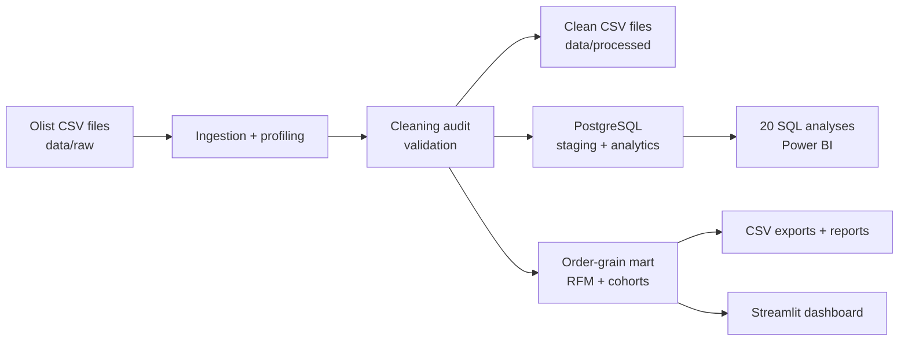

# Architecture

The ETL command reads raw data without modifying it. Cleaning produces separately exported datasets and a row-level audit summary. Validation verifies key uniqueness, relationships, financial constraints, and missingness. The order mart aggregates order items before combining them with order attributes, so metrics stay at a safe order grain. A separate item mart powers product/category drill-downs; it is not used to calculate order-level KPIs.

## Fact grains

- `fact_orders`: one row per order
- `fact_order_items`: one row per order-item
- `fact_payments`: one row per payment transaction
- `fact_reviews`: one row per review record

Payment totals are intentionally not joined to item GMV. Joining these two detail facts would multiply records for multi-item/multi-payment orders.
